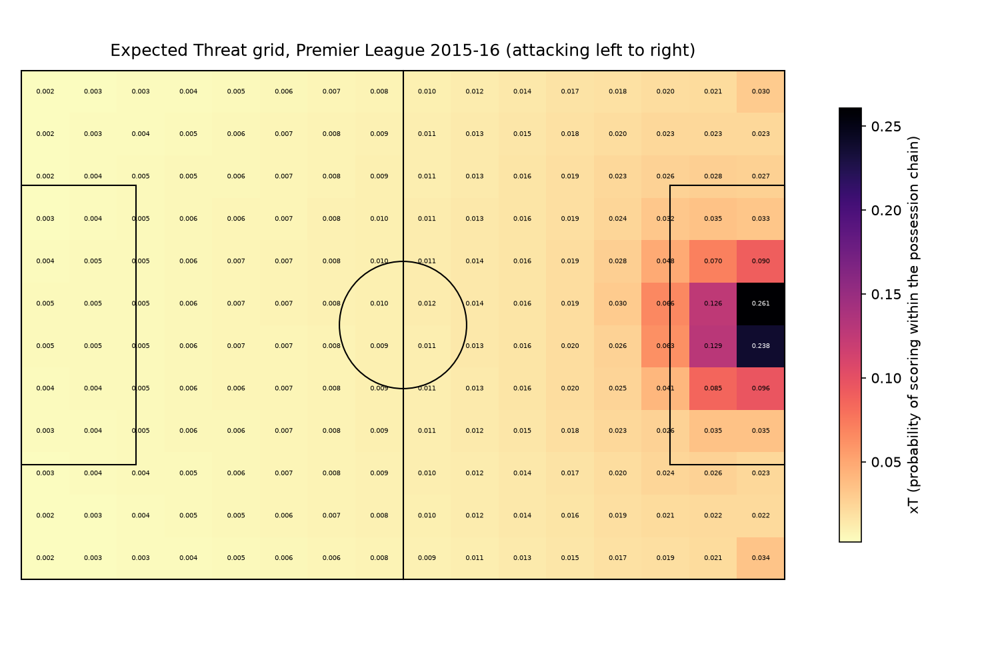
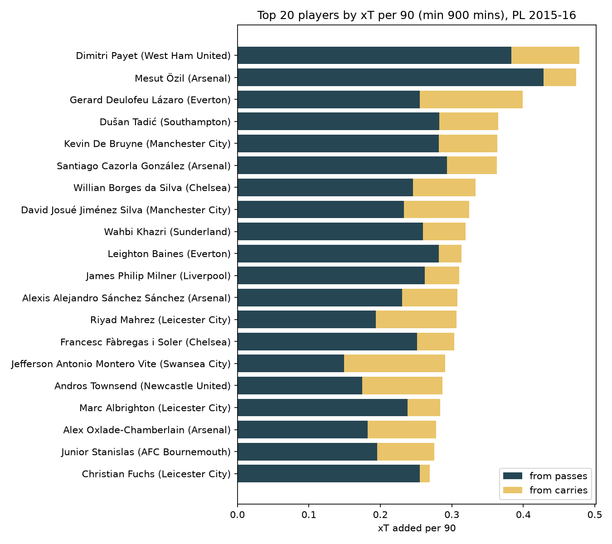
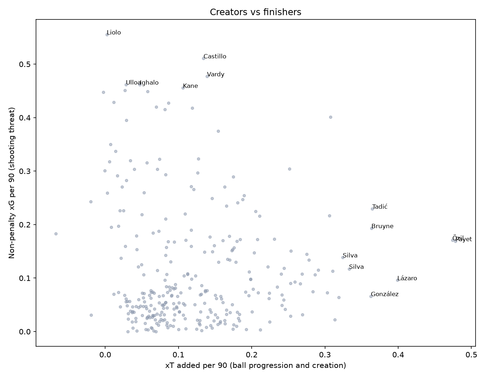
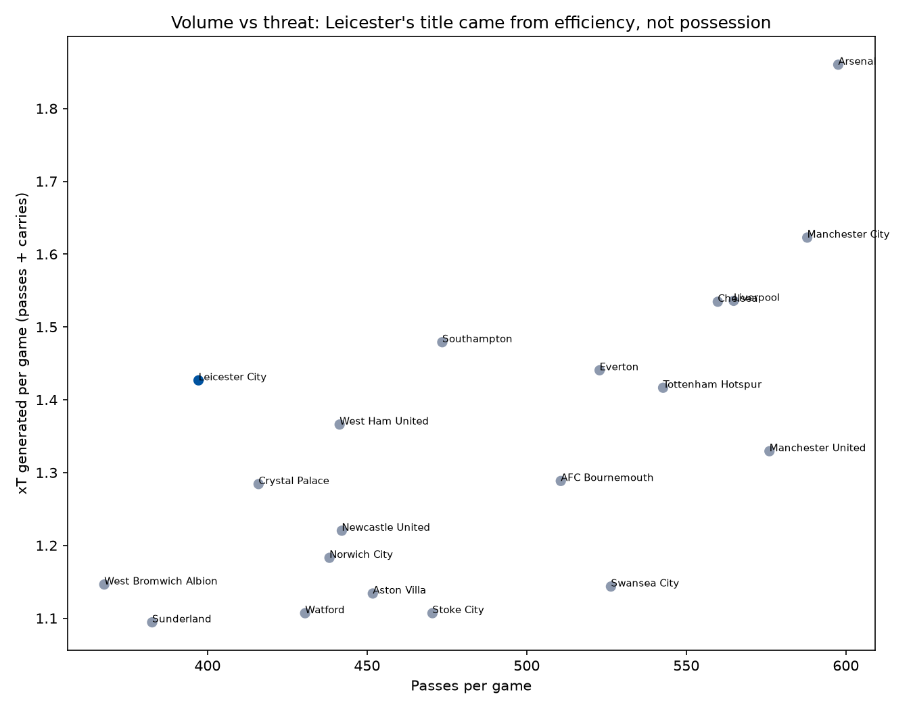
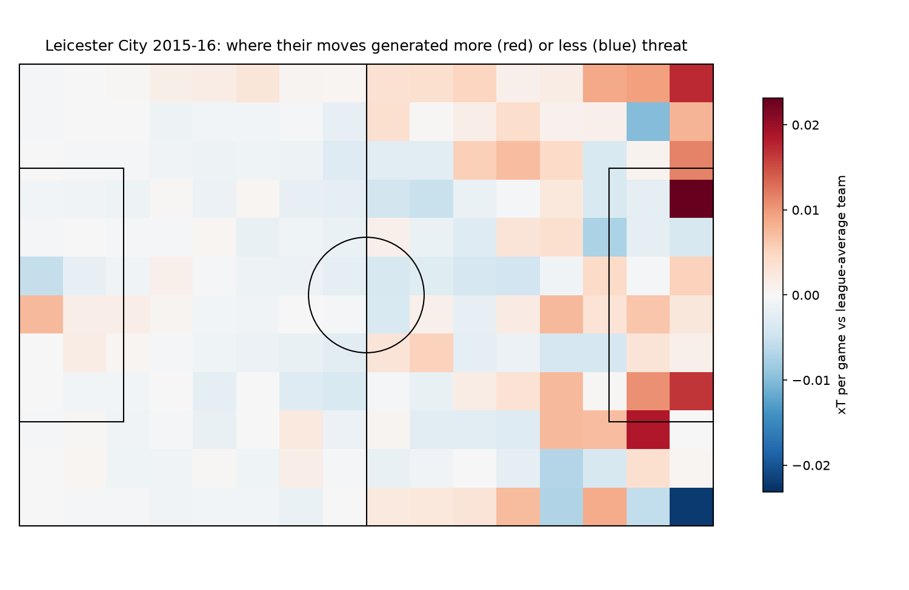

# Expected Threat (xT): valuing every pass and carry in the 2015-16 Premier League

A possession value model built from scratch on **StatsBomb open event data**. Each zone of the pitch gets a probability
that a possession from there ends in a goal, and every successful pass or carry is then credited with the threat it adds.
Goals and assists only reward the last touch. xT credits the players who move the ball into dangerous areas, which is what
recruitment and analysis departments want to measure.

Author: Anthony Adusei-Poku ([@anthony07-max](https://github.com/anthony07-max))



## Key findings (380 matches, 645,568 passes and carries, 9,908 shots)
1. **Threat is concentrated near goal.** The best zone (central, just outside the six-yard box) is worth 0.26, which is
   about 85 times a zone in your own box (0.003). Moving the ball from midfield to the edge of the box roughly multiplies its value by 5 to 10.
2. **Payet and Özil were the league's top ball progressors.** Dimitri Payet (West Ham, 0.48 xT per 90) and Mesut Özil
   (Arsenal, 0.47) were clear of De Bruyne, Tadić and Cazorla. Özil did it almost entirely with passes, while Deulofeu, Ibe,
   Montero, Martial and Hazard led for carries.
3. **Full-backs matter.** Leighton Baines (0.31) and Leicester's Christian Fuchs (0.27) were the top-rated defenders.
4. **Leicester won the league on efficiency, not possession.** They were 7th for xT per game but made the
   **fewest passes but two** (15,093). That gave them the **highest threat per pass in the league** (0.36 xT per 100 passes, against
   Arsenal's 0.31 and Man United's 0.23). Mahrez (0.31 per 90) and Albrighton (0.28) were their main sources, and the zone map
   shows the extra threat came from wide areas and crosses.
5. **The model passes a sanity check.** Team xT per game correlates with goals at r = 0.79 and with StatsBomb xG at r = 0.83, without ever
   seeing who scored from each possession. About 28% of all xT comes from carries, not passes.

| | |
|---|---|
|  |  |
|  |  |

## Method
- **Grid:** 16 × 12 zones on StatsBomb's 120 × 80 pitch.
- For each zone the model estimates the shot probability *s*, the move probability *m*, the goal probability per non-penalty shot *g*, and a
  transition matrix *T* of where **successful** moves from that zone end up. It then solves `xT = s·g + m·(T · xT)` by value iteration
  (51 iterations to converge). Failed passes count towards *m* but transfer no value, so the risk of losing the ball is built in.
- **Player credit:** each successful pass or carry earns `xT(end) − xT(start)` and can be negative. Totals are converted to per 90 using minutes
  reconstructed from line-ups and substitutions (minimum 900 minutes).
- **Limitations:** a static model of the ball's location only. It doesn't account for defensive pressure, body shape or game state,
  and it doesn't credit off-ball runs or defensive actions. Red cards are not deducted from minutes.
  The data comes from one season, and StatsBomb released it for research.

## Data source
- [StatsBomb Open Data](https://github.com/statsbomb/open-data): Premier League 2015-16 events (competition 2, season 27).
  Used under the [StatsBomb public data user agreement](https://github.com/statsbomb/open-data/blob/master/LICENSE.pdf). Data provided by **StatsBomb (Hudl)**.
- Method reference: Karun Singh, [Introducing Expected Threat (xT)](https://karun.in/blog/expected-threat.html) (2018).

## Project structure
```
src/download.py      # streams StatsBomb event JSON and keeps a compact parquet (data/raw/, git-ignored)
src/clean.py         # passes/carries, shots, minutes played
src/xt.py            # the xT model (fit + action valuation)
src/analysis.py      # rankings, team analysis, charts, key_findings.json
app/streamlit_app.py # player explorer
```

## How to run
```bash
python -m venv .venv && source .venv/bin/activate
pip install -r requirements.txt
bash run_pipeline.sh      # downloads about 1.3 GB of JSON (stored as about 15 MB parquet), then about 10 s of analysis
streamlit run app/streamlit_app.py
```
